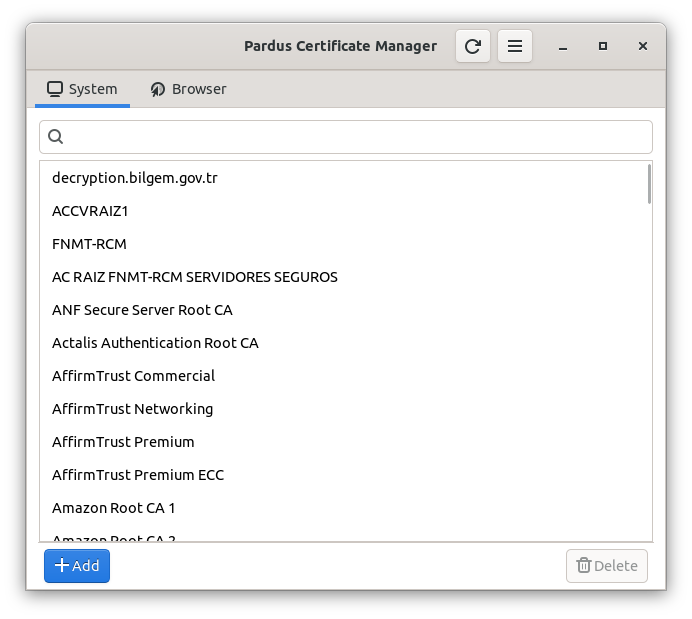

# Pardus Certificate Manager


[🇹🇷](./README_TR.md) | [🇬🇧](./README.md)

## Introduction

Pardus Certificate Manager is a simple application that helps you manage trusted certificates on your Linux computer. You can inspect a certificate before trusting it, add your own CA certificates to the system trust store, and manage the certificates stored in your web browsers, all from a single window.


## Features

- List system and user-added certificates in the trust store
- Import CA certificates from a PEM file
- Detailed certificate preview before trusting (subject, issuer, validity, serial, SHA-256 fingerprint)
- Clear warnings for expired, not-yet-valid, self-signed, and non-CA certificates
- Manage browser certificates for Firefox profiles and Chrome/Chromium
- Import, export, and delete certificates per browser profile
- Safe removal, (only user-added certificates can be deleted)

## Installation

### Requirements

Before installing Pardus Certificate Manager, ensure your system meets the following requirements:

- `python3`: *Pardus Certificate Manager is built with Python3*
- `python3-gi`: *Allows Python to use GTK and GNOME libraries.*
- `gir1.2-gtk-3.0`: *Provides the library for building windows and buttons.*
- `gir1.2-glib-2.0`: *GLib bindings for Python.*
- `python3-cryptography`: *Reads and parses X.509 certificates.*
- `ca-certificates`: *Provides `update-ca-certificates` to refresh the system trust store.*
- `libnss3-tools`: *Provides `certutil` for managing browser certificate stores.*
- `pkexec`: *Runs privileged trust store changes with PolicyKit authorization.*

### Usage

  - __From Package Manager__

    ```bash
    sudo apt install pardus-certificate-manager
    ```

  - __From Source__

    ```
    # Clone the repository
    git clone https://github.com/pardus/pardus-certificate-manager

    # Navigate to the project directory
    cd pardus-certificate-manager

    # Install dependencies
    sudo apt install python3 python3-gi gir1.2-gtk-3.0 gir1.2-glib-2.0 \
        python3-cryptography ca-certificates libnss3-tools pkexec

    # Run the application
    python3 src/Main.py

    ```

### Usage Guide



 ##### Managing System Certificates

  1. Launch the application
  2. The system trust store certificates are listed on the first page
  3. Click the "Add" button and choose a PEM certificate file
  4. Review the certificate details and warnings in the preview dialog
  5. Confirm to install it, you will be asked for your password
  6. Select a user-added certificate and click "Delete" to remove it

 ##### Certificate Details

  - The preview dialog shows the subject, issuer, validity dates, serial number, SHA-256 fingerprint, and whether the certificate is a CA
  - Warnings are shown for expired, not-yet-valid, self-signed root, and non-CA certificates

 ##### Managing Browser Certificates

  - Switch to the browser page and pick a Firefox profile or Chrome/Chromium from the list
  - Import a CA certificate, export an existing one to a PEM file, or delete a certificate from the selected profile

> __Notes:__
    - Adding or removing system certificates requires administrator privileges via `pkexec`
    - System certificates are stored in `/usr/local/share/ca-certificates/` and refreshed with `update-ca-certificates`
    - Browser certificates are managed in each browser's NSS database using `certutil`
