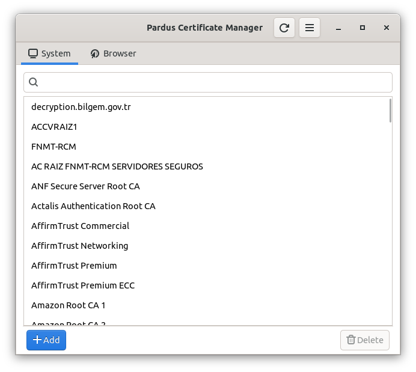

# Pardus Sertifika Yöneticisi


[🇹🇷](./README_TR.md) | [🇬🇧](./README.md)

## Giriş

Pardus Sertifika Yöneticisi, Linux bilgisayarınızdaki güvenilir sertifikaları yönetmenize yardımcı olan basit bir uygulamadır. Bir sertifikaya güvenmeden önce inceleyebilir, kendi CA sertifikalarınızı sistem güven deposuna ekleyebilir ve web tarayıcılarınızda saklanan sertifikaları tek bir pencereden yönetebilirsiniz.


## Özellikler

- Güven deposundaki sistem ve kullanıcı sertifikalarını listeleme
- PEM dosyasından CA sertifikası içe aktarma
- Güvenmeden önce ayrıntılı sertifika önizlemesi (konu, veren, geçerlilik, seri numarası, SHA-256 parmak izi)
- Süresi dolmuş, henüz geçerli olmayan, kendinden imzalı ve CA olmayan sertifikalar için uyarılar
- Firefox profilleri ve Chrome/Chromium için tarayıcı sertifikalarını yönetme
- Tarayıcı profili bazında sertifika içe aktarma, dışa aktarma ve silme
- Güvenli silme, (yalnızca kullanıcının eklediği sertifikalar silinebilir)

## Kurulum

### Gereksinimler

Pardus Sertifika Yöneticisi uygulamasını kurmadan önce, sisteminizin aşağıdaki gereksinimleri karşıladığından emin olun:

- `python3`: *Pardus Sertifika Yöneticisi, Python 3 ile geliştirilmiştir*
- `python3-gi`: *Python'un GTK ve GNOME kütüphanelerini kullanmasını sağlar.*
- `gir1.2-gtk-3.0`: *Pencere ve buton oluşturmak için kütüphane sağlar.*
- `gir1.2-glib-2.0`: *Python için GLib bağlantıları.*
- `python3-cryptography`: *X.509 sertifikalarını okur ve çözümler.*
- `ca-certificates`: *Sistem güven deposunu yenilemek için `update-ca-certificates` aracını sağlar.*
- `libnss3-tools`: *Tarayıcı sertifika depolarını yönetmek için `certutil` aracını sağlar.*
- `pkexec`: *Ayrıcalıklı güven deposu değişikliklerini PolicyKit yetkilendirmesiyle çalıştırır.*

### Kullanım

  - __Paket Yöneticisinden__

    ```bash
    sudo apt install pardus-certificate-manager
    ```

  - __Kaynaktan__

    ```
    # Depoyu klonlayın
    git clone https://github.com/pardus/pardus-certificate-manager

    # Proje dizinine gidin
    cd pardus-certificate-manager

    # Bağımlılıkları kurun
    sudo apt install python3 python3-gi gir1.2-gtk-3.0 gir1.2-glib-2.0 \
        python3-cryptography ca-certificates libnss3-tools pkexec

    # Uygulamayı çalıştırın
    python3 src/Main.py

    ```

### Kullanım Kılavuzu

<p align="center">
  
</p>

 ##### Sistem Sertifikalarını Yönetme

  1. Uygulamayı başlatın
  2. Sistem güven deposundaki sertifikalar ilk sayfada listelenir
  3. "Ekle" butonuna tıklayın ve bir PEM sertifika dosyası seçin
  4. Önizleme penceresinde sertifika ayrıntılarını ve uyarıları inceleyin
  5. Kurmak için onaylayın, sizden parolanız istenecektir
  6. Kullanıcının eklediği bir sertifikayı seçip "Sil" butonuna tıklayarak kaldırın

 ##### Sertifika Ayrıntıları

  - Önizleme penceresi; konu, veren, geçerlilik tarihleri, seri numarası, SHA-256 parmak izi ve sertifikanın bir CA olup olmadığını gösterir
  - Süresi dolmuş, henüz geçerli olmayan, kendinden imzalı kök ve CA olmayan sertifikalar için uyarılar gösterilir

 ##### Tarayıcı Sertifikalarını Yönetme

  - Tarayıcı sayfasına geçin ve listeden bir Firefox profili ya da Chrome/Chromium seçin
  - Seçili profile bir CA sertifikası içe aktarın, mevcut bir sertifikayı PEM dosyasına dışa aktarın veya profilden silin

> __Notlar:__
    - Sistem sertifikalarını eklemek veya kaldırmak `pkexec` aracılığıyla yönetici yetkisi gerektirir
    - Sistem sertifikaları `/usr/local/share/ca-certificates/` dizininde saklanır ve `update-ca-certificates` ile yenilenir
    - Tarayıcı sertifikaları, her tarayıcının NSS veritabanında `certutil` kullanılarak yönetilir
